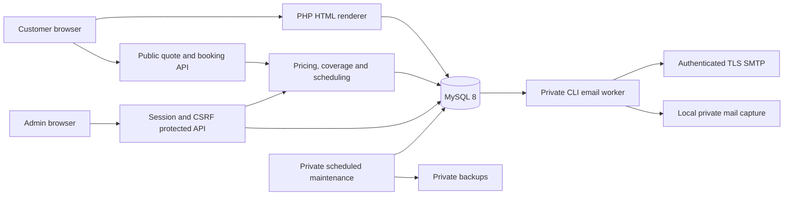

# Application architecture

The deployment is one PHP application plus MySQL and private scheduled PHP commands. HTML/CSS/JavaScript is served directly; there is no bundler or long-running Node application.

`public/` is the local web root; the deployment package renames it to `public_html/`. `app/bootstrap.php` selects the appropriate public path. Domain services, configuration, scripts and storage remain above the web root. Apache `.htaccess` routes API requests and HTML pages; `router.php` provides equivalent routing for local PHP development. Source HTML supplies layouts; the renderer inserts admin-managed publication/catalogue/settings and metadata before sending complete HTML.

Public quote calculation is server authoritative. Saved requests contain immutable commercial snapshots and policy versions. Database transactions connect reservations, request versions, histories, idempotency and email outbox. Workers claim committed notifications and send outside the request transaction. No external CRM, payment provider or staff dispatch dependency is required.

The admin console is a small vanilla JavaScript client with typed forms generated from allowlisted server schemas. Owners configure catalogue/publication/settings; operators handle requests and delivery. Uploaded files are validated raster images; arbitrary HTML/scripts cannot be published through content fields.

Production HTTPS, private secrets, role/CSRF checks, password hashing, encrypted SMTP credentials, noindex on nonproduction and a live-intake readiness gate are enforced by PHP. Scheduled jobs provide delivery, cleanup and backups. See [deployment](DEPLOYMENT.md) for host-specific acceptance and monitoring.
