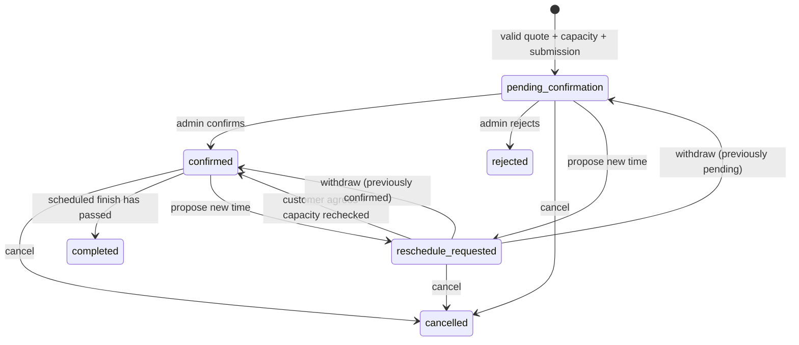
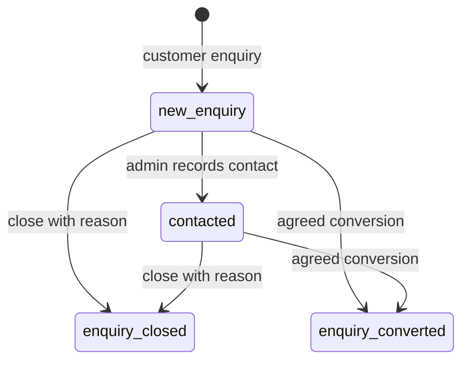

# Booking and enquiry lifecycle

The portal accepts service requests with manual business confirmation. Payment preference is pay on completion; this website does not charge a card.

A pending, confirmed or reschedule-requested booking occupies its original full interval, including the configured buffer. A proposed time is not separately held. Acceptance locks the old/new schedule days and swaps the reservation atomically; competing capacity or changed rules cause a rollback. Cancellation/rejection releases capacity. Completion requires a confirmed appointment whose scheduled finish has passed. A reschedule originating from a pending request can also be rejected.

Quote amendments require a fresh current quote and recorded customer agreement. They keep old/new commercial snapshots in history and revalidate duration/capacity at the booked start. Editing a package/extra in the catalogue does not amend existing requests.

Enquiries never reserve a time. Conversion requires a valid classified vehicle, package, coverage, fresh quote, available time and customer agreement. It creates exactly one source-linked booking; optional immediate confirmation reflects that agreement. A unique source constraint and transaction prevent duplicate conversions.

All writes require authentication/CSRF and the current record version. Notes, status changes and reasons are recorded. Applicable customer/admin notifications are queued in the same transaction and delivered independently by the worker. A failed email never rolls back an accepted request; the failure is visible and retryable.
