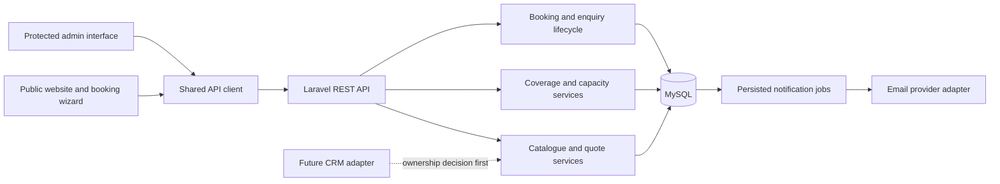
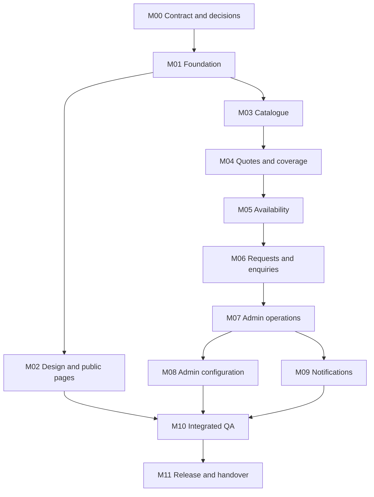

# SteamRex Booking Portal — implementation plan

> Development update, 31 October 2026: the user requested build-free HTML/CSS/JavaScript for Simply.com. Code now uses small PHP/PDO services and MySQL instead of Vite/Tailwind/Laravel. This document preserves the planning baseline. [README.md](../README.md), [API_CONTRACT.md](API_CONTRACT.md) and [HANDOVER.md](HANDOVER.md) describe the complete implemented application and the hosting configuration checklist.

**Date:** 31 October 2026  
**Status:** Historical planning baseline; implementation is complete. See HANDOVER.md for current scope and hosting acceptance.  
**Baseline:** User-supplied roadmap v1.0, all 17 pages reviewed.  
**Companions:** [Decisions](DECISIONS.md) and [task backlog](MODULE_BACKLOG.md).

## 1. Product interpretation

This is a public service website backed by a booking system and a lean operational admin dashboard. The difficult part is keeping displayed prices, service coverage, available capacity and admin actions consistent.

The first release must let a customer choose a service and vehicle, compare exactly three eligible packages, choose extras, check coverage and submit either:

- A **pay-after-wash booking request**, initially `pending_confirmation`, with `pay_on_completion` recorded. No money is collected through this website.
- An **enquiry**, initially `new_enquiry`, which does not promise or reserve an appointment.

Admins review requests, explicitly confirm appointments, manage operational settings and maintain the catalogue. Booking history must remain accurate when catalogue data changes.

### Scope boundaries

| Included in v1 | Outside v1 unless scope changes |
| --- | --- |
| Original responsive public site and service pages | Online payments, refunds and payment gateways |
| Vehicle makes, models, classes and Other vehicle path | Customer accounts and customer dashboard |
| Three admin-configured package tiers per enabled service/class | Subscriptions, gift cards and multiple-car orders |
| Eligible add-ons and server-calculated quotes | Coupons and promotional pricing engine |
| Postcode coverage and duration-aware availability | Staff assignment, dispatch, route optimization and live tracking |
| Booking and enquiry submission | Revenue analytics and financial reporting |
| Admin inbox, lifecycle actions, catalogue and availability management | General content CMS and review moderation |
| Email acknowledgements, admin alerts, audit and delivery history | SMS/WhatsApp or CRM synchronization before provider/scope agreement |

Service descriptions belong to the service catalogue and are editable there. General homepage/FAQ/legal content can be maintained in source. Genuine approved testimonials can be presented without building a review-management system.

## 2. Reference site and visual direction

The reviewed [SteamRex homepage](https://steamrex.com/) exposes make/model price discovery, service selection, coverage messaging and pay-after-cleaning messaging. Its [subscription page](https://steamrex.com/s365) describes a separate recurring-service product. Its [FAQ](https://steamrex.com/kundeservice) explains service and payment expectations. These are flow references; subscriptions and account features do not enter our v1 scope.

The text-based review does not establish the full behavior of SteamRex's interactive checkout or private systems. The package-card requirements come from the supplied roadmap, not a verified inspection of those systems.

Our proposed direction follows the PDF: midnight/navy, warm off-white, restrained teal, generous spacing, clear typography and original vehicle/detailing imagery. Build a compact design system before page-by-page styling. Keep motion subtle and honor reduced-motion preferences. Do not invent customer counts, testimonials, environmental claims or discounts.

## 3. Architecture and ownership

Use one repository with separate frontend and backend applications, shared API schemas and shared fixtures. One REST API serves both customer and admin interfaces.



| Layer | Planned choice | Responsibility |
| --- | --- | --- |
| Frontend | Vite + vanilla JavaScript ES modules + HTML + Tailwind | Presentation, navigation, wizard state, usable validation and API calls |
| API | Laravel; provisionally Laravel 13 with PHP 8.3+ | Authoritative validation, pricing, availability, lifecycle, authorization and audit |
| Database | MySQL; select supported production version in M01 | Transactions, constraints, snapshots and history |
| Auth | Framework-managed admin sessions; same-origin topology preferred | Secure cookies, CSRF protection, throttling, server-side policies and logout |
| Notifications | Persisted jobs with email-provider adapter | Deliver after commit, retry failures and show delivery history |
| Media | Local development files; production static/object storage as needed | Approved public imagery; no customer uploads in v1 |
| Hosting | PHP-capable server with MySQL and worker support; static frontend may use a CDN | HTTPS, process supervision, migrations, backups and monitoring |

The roadmap leaves the Laravel major version open. [Laravel's support table](https://laravel.com/framework/docs/releases) lists Laravel 13 as requiring PHP 8.3+, with security support through March 2028. Confirm the host before pinning versions. A new project should not default to an older major solely because the PDF mentions PHP 8.2.

Use the [documented Tailwind Vite integration](https://tailwindcss.com/docs/installation/using-vite) for the selected version. The PDF's sample `tailwind.config.js` filename is illustrative rather than a requirement to reproduce an older setup.

Do not move the PHP API to a JavaScript/Workers backend to suit a hosting tool. Choose hosting that supports the agreed architecture. This planning stage creates no hosted Site.

### Proposed repository boundaries

```text
README.md
docs/                     Product, architecture, contracts, lifecycle and handover
frontend/
  src/app/                Router, configuration, API client and shared state
  src/components/         Accessible reusable controls
  src/modules/            Catalogue, pricing, location, scheduling, requests, admin
  src/pages/              Public and admin page composition
  src/styles/             Tokens, base styles and component styles
backend/
  app/Http/               Controllers, validation requests and API resources
  app/Services/           Quote, coverage, capacity, booking and enquiry rules
  app/Policies/           Admin permissions
  app/Jobs/               Notification delivery
  database/               Migrations, seeders and factories
  tests/                  Domain and HTTP feature tests
shared/
  openapi.yaml            Machine-readable contract, produced in M00
  fixtures/               Contract-shaped examples used by mocks and tests
  schemas/                Supporting schemas where needed
```

Controllers remain thin. Avoid repository wrappers for every simple ORM operation. Put complex transactions and cross-module rules in named services. All frontend HTTP traffic uses one API client with interchangeable mock and real transports.

## 4. Customer journey and pages

### Booking flow

`Service → Vehicle → Package → Extras → Location → Schedule → Contact → Intent → Review → Submit`

Show a persistent summary on desktop and a compact expandable summary on mobile. Let customers go back without losing valid work. If an upstream choice changes, clear dependent selections and obtain a fresh quote and availability; never quietly retain an incompatible package or slot.

The hero can offer vehicle-first quick-start. Both entry paths feed the same booking state. A user who chooses enquiry can skip schedule. Unsupported areas or vehicles without a known class lead to a clearly labelled enquiry fallback.

Store only non-sensitive selections in any browser persistence. Do not put customer details, addresses, verification tokens or full quotes in URLs or analytics. Refresh quote and availability when resuming an old selection.

| Page group | Deliverables |
| --- | --- |
| Public discovery | `/`, `/services`, `/services/:slug`, `/how-it-works` |
| Coverage and support | `/service-areas`, `/contact`, `/privacy`, `/terms` |
| Booking | `/book`, success view with reference and next steps |
| Admin entry and inbox | Login, overview counts, booking list/detail, enquiry list/detail |
| Admin configuration | Services, packages/prices, vehicles/classes, add-ons, coverage, availability, users and audit |

The success URL's reference is not permission to read customer data. Refreshable private status details require separate verification. Customer self-service cancellation/rescheduling is not assumed; v1 can direct customers to contact the business while admins record the action.

## 5. Modules and completion gates

Every module ships UI states, relevant API behavior, meaningful tests and documentation together. Initial admin routing/authentication groundwork can begin in M01; admin business screens arrive when their services exist.

### M00 — Product rules and shared API contract

**Depends on:** Planning review and required business inputs. **Roadmap phase:** 0.

- Resolve data ownership, business locale, confirmation/capacity policy, unknown-vehicle behavior, pricing/tax treatment and hosting assumptions.
- Define endpoint schemas, status enums, authentication, ID types, money/date formats, pagination, validation and business-error envelopes.
- Specify quote IDs/expiry, submission idempotency, duration-aware availability, enquiry fallback and enquiry conversion.
- Produce `PRODUCT_SCOPE.md`, `API_CONTRACT.md`, `shared/openapi.yaml`, `DATABASE_SCHEMA.md`, `BOOKING_LIFECYCLE.md` and initial `ARCHITECTURE.md`.
- Add representative fixtures for normal, unavailable, invalid, expired and conflict cases. The contract must describe these before UI developers need them.

**Gate:** Frontend and backend have matching examples and unambiguous business rules. No unresolved decision blocks the next module; remaining provisional settings are explicitly identified.

### M01 — Repository and runtime foundation

**Depends on:** M00. **Roadmap phase:** 1.

- Verify Windows development prerequisites: Node/npm, PHP/extensions, Composer and a running database. Choose native setup or containers based on availability; do not assume Docker is installed.
- Scaffold independently runnable frontend and Laravel API, environment examples, API version prefix, health endpoint and shared configuration.
- Establish initial migrations, deterministic reference seed data, test database, API client/mock transport and route shells.
- Set up checks for frontend production build, schema/fixture validation and backend tests, with secrets excluded from source control.
- Document local ports, startup steps, database setup, admin provisioning and worker startup.

**Gate:** A fresh checkout can run both applications using the README; health, mock transport and build checks work. No booking logic is needed yet.

### M02 — Design system and public presentation

**Depends on:** M00 and M01; integrates M03 data when ready. **Roadmap phases:** 1–2, polished in 9.

- Define colors, type, spacing, layout, form, focus, error and motion tokens.
- Build reusable buttons, fields, selectors, cards, modal/drawer, accordion, stepper, alerts and loading states.
- Assemble public pages, original hero, process explanation, approved trust assets and booking entry points.
- Include keyboard interaction, accessible labels, reduced-motion behavior and mobile layouts immediately.
- Choose static/prerendered output for public SEO pages in M01; booking/admin interactions remain client-side.

**Gate:** Responsive public preview and working navigation with contract fixtures; content ownership and missing assets are visible. No fabricated business claims or client-side price calculations.

### M03 — Service, vehicle and package catalogue

**Depends on:** M00 and M01; UI uses M02. **Roadmap phase:** 2.

- Model services, makes, models, classes, package tiers, add-ons, eligibility and model-price overrides.
- Expose public read endpoints with active-state filtering and stable IDs.
- Build make/model selectors, service selection, Other route and three package cards with details, price, inclusions and duration.
- Enforce three distinct published tiers for each enabled service/class. Return a structured unavailable state when the combination is incomplete.
- Derive a known model's class on the server. Handle unclassifiable vehicles through enquiry until classification rules are agreed.

**Gate:** Supported context returns exactly three valid cards; changing make/model clears invalid selections; incomplete or unknown contexts offer enquiry; browser class tampering cannot lower the authoritative price.

### M04 — Quotes, add-ons and service coverage

**Depends on:** M03. **Roadmap phase:** 3.

- Implement class price, eligible model override, add-ons, approved area surcharge and confirmed tax treatment using integer minor units.
- Return persisted or verifiable quote ID, itemized amount, duration, currency, expiry and relevant catalogue/area version.
- Validate postcode coverage and normalize the address according to the configured market; avoid public address lookup or exposure of customer records.
- Build extras, postcode feedback and server quote summary. Ensure location changes refresh both quote and slots.
- Unsupported postcode blocks booking but allows enquiry. Quote/package/slot requirements must relax for that enquiry path.

**Gate:** Browser-tampered values are ignored; expired or relevant-price-changed quotes require review of a refreshed quote; unsupported coverage offers a usable enquiry path.

### M05 — Duration-aware availability and capacity

**Depends on:** M04. **Roadmap phase:** 4.

- Model business hours, slot interval, maximum concurrent jobs, lead time, blocked dates and configurable travel buffer.
- Use quoted service duration plus buffer to test the entire occupied interval, not only its start time. Proposed scheduling duration is the quoted maximum where the package exposes a range.
- Return eligible future start times, business timezone and opaque slot identifiers. A displayed slot is not a reservation.
- Implement reusable transactional allocation/release logic for request creation, confirmation, reschedule, cancellation and enquiry conversion.
- Build date/time states for loading, no service, fully booked, expired selection and conflict.

**Gate:** Overlapping requests cannot exceed capacity, including requests with different start times; boundaries and daylight-saving changes behave correctly where relevant. The production database engine is used for concurrency tests.

### M06 — Booking and enquiry submission

**Depends on:** M04 and M05; public components from M02. **Roadmap phase:** 5.

- Build contact, intent, consent, review and success/error steps, with server-validated details and actionable field errors.
- Create booking requests atomically with quote validation, active catalogue checks, coverage recheck, allocation, snapshots, reference and audit event.
- Use a durable idempotency record: same key/payload replays the original result; same key/different payload conflicts. Network retry cannot create a second booking or enquiry.
- Create enquiries without consuming capacity and with optional preferred time and quote/package fields when the context is unsupported.
- Persist terms/privacy version and acceptance timestamp; separate service acknowledgement from marketing consent.

**Gate:** Both flows create the correct records. Duplicate retries, stale quotes, disabled catalogue, changed coverage and last-capacity races return the agreed results. Success text distinguishes receipt from confirmation.

### M07 — Admin authentication and request operations

**Depends on:** M06 for request workflows; auth setup can precede it. **Roadmap phase:** 6.

- Implement secure admin login/logout/current-user endpoints, throttling, session expiry and authorization policies. No public signup.
- Build operational overview counts, searchable/paginated booking and enquiry lists and detailed records.
- Implement confirmation, rejection, cancellation, completion, admin notes and reschedule negotiation using explicit allowed transitions.
- Implement enquiry contact/close/convert actions; conversion uses ordinary booking validation and capacity allocation and preserves its source enquiry.
- Add immutable lifecycle/audit history and optimistic version checks for conflicting admin edits.

**Gate:** Unauthorized callers cannot access admin data or actions; invalid transitions fail; reschedule/conversion cannot overbook; lists and detail expose all roadmap-required fields only to permitted admins.

### M08 — Admin catalogue and operational configuration

**Depends on:** M03–M05 and M07 authentication. **Roadmap phase:** 7.

- Add service descriptions, package tiers/pricing/inclusions, model overrides, vehicles/classes and add-on management.
- Add coverage, surcharge if agreed, business hours, capacity, holidays, lead time and buffer controls.
- Support super-admin provisioning/management and a minimal permission structure; audit sensitive changes.
- Prevent partial three-tier publishing. Safely deactivate referenced records and preserve existing booking snapshots.
- Preview affected combinations and upcoming appointments when disabling a service area or changing working hours; do not silently cancel existing work.

**Gate:** Approved configuration changes appear through public APIs without a frontend redeploy; caches invalidate; existing bookings retain their original commercial snapshots and allocated appointments.

### M09 — Notifications and delivery visibility

**Depends on:** M06 and M07 events; event hooks are defined earlier. **Roadmap phase:** 8.

- Add customer request/enquiry acknowledgements, admin new-request alerts, appointment confirmation and agreed change/cancellation messages.
- Persist notification intent with the domain transaction; dispatch/deliver after commit with retry and failed-job monitoring.
- Use templates that distinguish a requested time from a confirmed appointment and display local time correctly.
- Record delivery status and expose it in admin detail. Use a local mail sink/fake provider for development.
- Prevent repeated jobs from creating avoidable duplicate sends; document provider idempotency limitations.

**Gate:** Provider outage cannot remove a booking or hide its reference; retries are visible; customers and admins receive the correct event-specific messages. SMS/WhatsApp remain optional future adapters.

### M10 — Integrated QA, security, accessibility and performance

**Depends on:** M02–M09. **Roadmap phase:** 9.

- Run the full customer/admin journeys against the real API and production database engine, replacing fixtures where appropriate.
- Verify price authority, expiry, idempotency, interval capacity, permission boundaries, public-data privacy and admin race handling.
- Exercise keyboard-only booking, modal focus, error announcements, screen sizes, reduced motion and agreed browser coverage.
- Optimize imagery, font loading and public-page SEO; inspect loading/error/empty/offline/retry states.
- Verify queue failures, sanitized logs, secrets handling, secure cookies and configuration for the selected deployment topology.

**Gate:** Critical journeys pass; no unresolved critical/high issue; residual issues and actual check results are recorded. Tests are not marked passed until run.

### M11 — Production release and developer handover

**Depends on:** M10, approved content/settings and provisioned infrastructure. **Roadmap phase:** 10.

- Configure staging/production, HTTPS, frontend routing, API/session topology, database, storage and supervised workers.
- Document environment configuration, migrations, secure first-admin creation, backup/restore and compatible rollback.
- Perform a restore drill and staging smoke test before production launch; deploy only when the user moves the task into release scope.
- Complete setup, architecture, API, schema, lifecycle, deployment, handover and changelog documents.
- Walk through customer requests, enquiries, admin confirmation and configuration edits with the business owner.

**Gate:** Verified production smoke tests and delivery, known-issue record, working restore procedure and a fresh-checkout handover. Rollback must account for database changes as well as frontend/API releases.

## 6. Delivery sequence and integration rhythm



This diagram shows dependency lanes for developers; it is not an instruction to spawn automated agents. A single developer can follow the same order. If separate frontend/backend developers are assigned later, fixtures and contracts allow UI work while the API is developed.

| Review milestone | Modules | Reviewable result |
| --- | --- | --- |
| A. Blueprint | M00 | Agreed rules, schemas, fixture examples and data model |
| B. Running foundation | M01 + initial M02 | Both applications run; public design direction is visible |
| C. Price discovery | M03–M04 + M02 integration | Real service/vehicle selection, three packages, extras, coverage and quote |
| D. Customer requests | M05–M06 | Complete booking and enquiry paths with real persistence |
| E. Daily operations | M07–M09 | Admin manages requests/settings and customers receive messages |
| F. Release candidate | M10 | Evidence for acceptance, security, accessibility and concurrency |
| G. Launch | M11 | Deployment, smoke checks and handover |

At every milestone: demonstrate one working scenario, record actual tests/builds, update docs and list only the remaining decisions relevant to the next module. Avoid accumulating all UI work before integrating backend behavior.

No calendar commitment is made at this planning stage. Estimate the backlog after M00, when CRM requirements, content readiness, hosting and developer availability are known. A required external CRM adds integration discovery and must be estimated explicitly.

## 7. Data model additions needed beyond the PDF sketch

Keep the roadmap's catalogue, bookings, enquiries, history, notes, audit and notification entities. The sketch also needs explicit persistence for:

| Entity or concern | Why it is needed |
| --- | --- |
| Quotes and quote line items | Stable `quote_id`, expiry, relevant price/configuration versions, input binding and snapshots |
| Capacity buckets/allocations | Lockable capacity across overlapping intervals; allocation/release must be transactional |
| Idempotency records | Unique operation/key, payload hash, completion result and retention policy |
| Notification outbox/jobs | Durable after-commit work and visible retry state |
| Enquiry-to-booking link and enquiry history | Preserve source context; make conversion exactly once and auditable |
| Consent metadata | Accepted document versions and timestamp without implying marketing permission |
| Operational settings | Business locale, currency, timezone and agreed rules without frontend constants |

Specify foreign keys, unique constraints and essential indexes in M00 before migrations. Exact table names remain a schema decision. Store UTC instants plus the business timezone used to interpret appointments. Soft-delete/deactivate catalogue data instead of breaking historical references.

## 8. Acceptance scenarios that control release

1. Supported vehicle/service returns exactly three published tiers; an incomplete combination offers enquiry.
2. Package, extras and area produce the expected server quote; browser price/class tampering cannot reduce it.
3. An expired or relevant-price-changed quote cannot submit silently at a different amount.
4. Unsupported area and unknown vehicle enquiries submit without a mandatory valid quote or slot.
5. Two concurrent submissions competing for the final overlapping capacity cannot both reserve it.
6. Retrying the same submission returns one reference and creates one record; changed payload with a reused key conflicts.
7. A booking request shows `pending_confirmation`; only explicit admin confirmation sends appointment-confirmed messaging.
8. Enquiry conversion validates present-day eligibility/price/capacity, preserves the source enquiry and cannot convert twice.
9. Failed rescheduling preserves the original reservation; cancellation/rejection releases capacity exactly once.
10. Admin price/package changes affect new quotes while historical bookings retain their original snapshots.
11. Public callers cannot read customer records; admin session, authorization and CSRF boundaries are enforced.
12. Email failure leaves the request intact, exposes its reference and retries through visible delivery history.
13. Keyboard and reduced-motion users can complete the public flow; errors and confirmation are understandable.
14. A new developer can run both applications from documentation and the operator can restore a backup.

## 9. Business inputs and next action

Highest-priority inputs are market/currency/timezone, CRM ownership, slot-capacity policy, final price/tax rules and target hosting. Brand name, original assets, coverage, package inclusions/durations, actual prices, contact details and approved legal text are also needed before their corresponding modules are finalized.

See [DECISIONS.md](DECISIONS.md) for proposed defaults and [MODULE_BACKLOG.md](MODULE_BACKLOG.md) for the execution checklist. The next implementation session should complete M00, then scaffold M01. It should not attempt the entire production application in one change.
